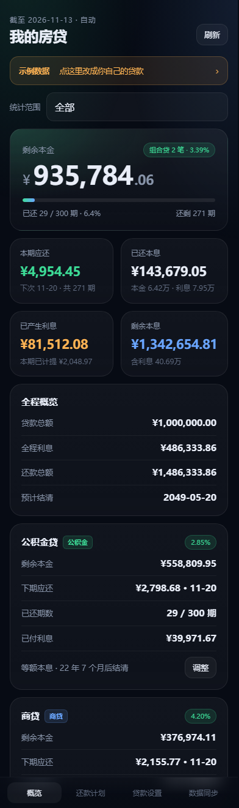
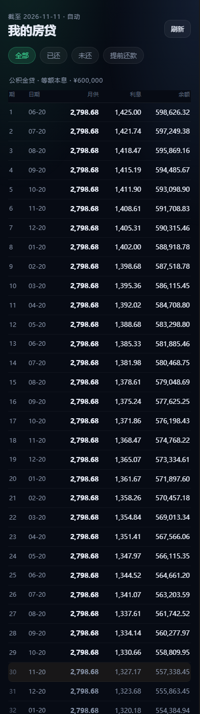
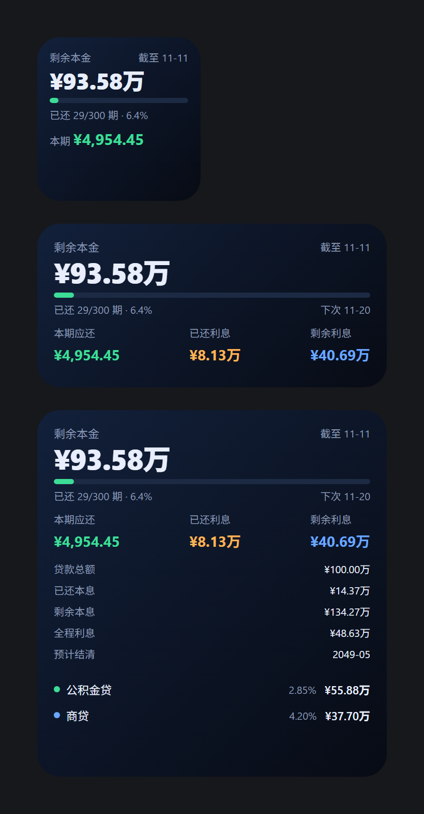
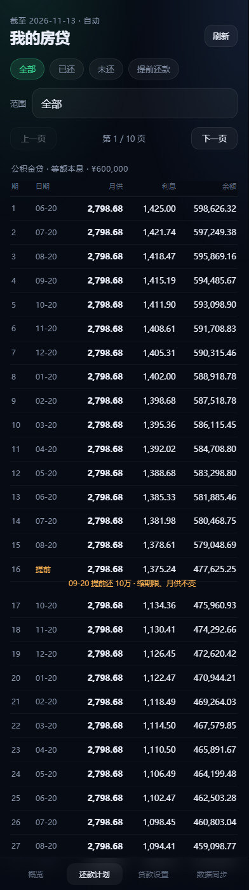
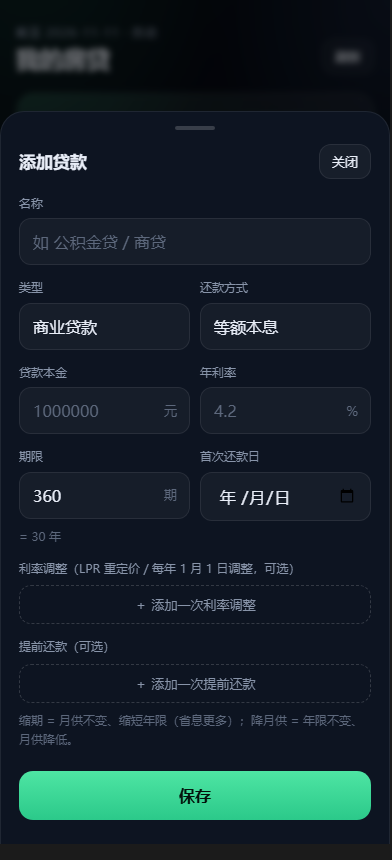

# 房贷看板

在 iPhone 上随时看清自己的房贷：**剩余本金、已还本息、剩余本息、已产生利息、本期应还、还剩几期**。

不装 App、不做小程序 —— 一个网页（加到主屏就是全屏应用）+ 一个桌面小组件。

> 在线版（已部署）：**https://jerry98998.github.io/loan/**
> 源码：https://github.com/jerry98998/loan

| 概览 | 还款计划 |
| --- | --- |
|  |  |

## 三分钟用起来

**① 看网页**（零配置）

- 电脑上双击 `web/index.html` 打开，先玩示例数据；
- 手机上换成自己的贷款数据：概览页 → 「贷款设置」→ 逐笔改本金/利率/期数/首次还款日。

**② 放到主屏**（当成 App 用）

已经部署好了：手机 Safari 打开 **https://jerry98998.github.io/loan/** → 分享 → **添加到主屏幕**。之后从图标打开就是全屏，没有地址栏，样式和字号都是照 iPhone 调的。

想自己再部署一份：把整个仓库推到 GitHub，Settings → Pages → 分支 `main` / 根目录 `/`。根目录的 `index.html` 只是一块跳板，会自动转到 `web/`。

> 要部署**整个仓库**，不只是 `web/`：页面要引用 `../engine/loan.js`（计算引擎）。
> 本地双击 `web/index.html` 也能直接跑，就是这个目录结构。

**③ 加桌面小组件**（可选，看一眼就知道还剩多少）

1. App Store 装 [Scriptable](https://scriptable.app/)（免费）
2. 打开本仓库的 `widget/dist/mortgage-widget.js`，全选复制，粘进 Scriptable 新建的脚本
3. 网页 → 「数据同步」→ 点 **复制小组件配置**，粘到脚本开头的 `CONFIG.state`
4. 长按桌面 → 左上角 `+` → Scriptable → 选小/中/大号

想让小组件自动跟着网页更新，再花 5 分钟部署 `worker/`（Cloudflare，免费），把地址和令牌填进脚本的 `CONFIG.remote`，此后页面点「上传到云端」即可，小组件自己会拉。



> 图里是三种尺寸的**效果示意**（按同样的字号和版式用 HTML 复刻，不是真机截图）。小号只看剩余本金；中号加本期应还、已还利息、剩余利息；大号再加已还本息、剩余本息、全程利息、预计结清和每笔明细。

## 能看什么

- **剩余本金**：真正还没还的钱，配进度条和「已还 29/300 期」
- **本期应还**：下一次要还多少、几号还
- **已还本息**：本金 / 利息分别是多少（组合贷自动合并）
- **已产生利息**：含当月已计提、还没到还款日的那部分
- **剩余本息**：未来还要掏多少钱，含利息
- **全程概览**：贷款总额、全程利息、还款总额、预计结清年月
- **分笔明细**：公积金 + 商贷各自剩余、下期应还、已还期数、已付利息
- **还款计划**：每一期的月供 / 利息 / 余额，可筛「已还 / 未还 / 提前还款」

| 提前还款 | 编辑贷款 |
| --- | --- |
|  |  |

## 怎么记数据（关键设计）

**不记流水，只记合同 + 事件。**

你只需要录入：本金、年利率、期数、还款方式、首次还款日。之后每一期的本息、余额、已还期数，全部**按日期当场推导**。

所以：

- ✅ **不需要「定时自动录入还款」**。没有后台任务、没有 cron、不会漏记、不会重复记，打开就是最新状态，换时区换设备都一致。
- ✅ 想穿越到未来看"明年这时候还剩多少"：把「数据基准日」改成未来的某天即可。

会改变计划的**事件**只有两种，都在「贷款设置 → 编辑」里加：

- **提前还款**：日期 + 金额 + 方式（缩期限月供不变 / 降月供期限不变 / 一次结清）
- **利率调整**（LPR 重定价）：生效日 + 新年利率，之后各期按新利率重算

## 计算口径

| 项目 | 口径 |
| --- | --- |
| 月利率 | 年利率 ÷ 12（页面上填 4.9 表示 4.9%） |
| 等额本息 | `月供 = P·r·(1+r)ⁿ / ((1+r)ⁿ−1)`，月供取整到分，末期抹平 |
| 等额本金 | 每期本金 = P/n，利息 = 剩余本金 × r |
| 已还期数 | 还款日 ≤ 基准日的期数（还款日当天算已还） |
| 已产生利息 | 已还各期利息 + 当期按天折算的已计提利息 |
| 提前还款 | 记在「还款日 ≥ 提前还款日」的那一期之后，当期先照常还月供 |
| 省下的利息 | 有提前还款时，再跑一遍「不提前还」的基线做差 |

引擎有 59 条断言覆盖：100 万 / 4.9% / 30 年月供 5307.27、总利息 910614.92、等额本金首期 6861.11、提前 20 万缩期 360→245 期、零利率、31 号顺延到 2 月 29 日等。

## 目录

```
engine/loan.js        计算引擎（UMD，浏览器 / Node / Scriptable 通用，纯函数零依赖）
engine/loan.test.js   59 条断言
web/index.html        页面
web/app.js            交互 + 渲染（无框架，localStorage）
web/style.css         深色移动端样式
web/manifest.webmanifest, icon-*.png   PWA 用
widget/mortgage-widget.js       小组件模板（含引擎内联标记）
widget/dist/mortgage-widget.js  构建产物，粘进 Scriptable 的就是它
worker/               Cloudflare Worker + KV 云同步（可选）
tools/build.js        把引擎内联进小组件
tools/test-*.js       页面 / 小组件 / worker 的无浏览器测试
```

## 数据存在哪

- 默认只在**这台手机的浏览器**里（localStorage），不上传任何地方。
- 「导出 JSON」得到一份完整备份；换手机就「导入 JSON」。
- 想要多设备 + 小组件自动更新，再开 `worker/`（自己的一台 Cloudflare Worker，数据在你自己的 KV 里）。

## 开发

```bash
node engine/loan.test.js     # 计算：59 passed
node tools/test-web.js       # 页面：56 passed（Node 里用最小 DOM 垫片跑）
node tools/test-widget.js    # 小组件：50 passed（Scriptable API 垫片）
node tools/test-worker.js    # 云同步：17 passed
node tools/build.js          # 改完 engine/ 后重新内联进小组件
```

更多设计取舍见 [docs/方案.md](docs/方案.md)。
